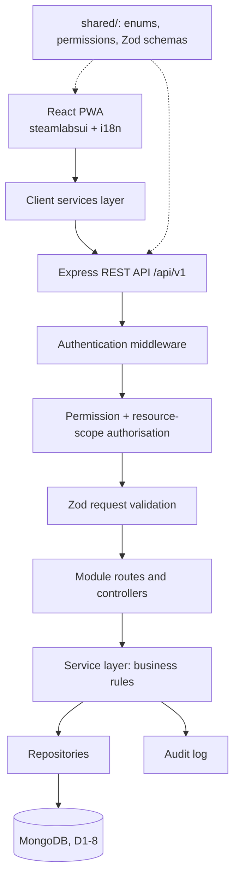
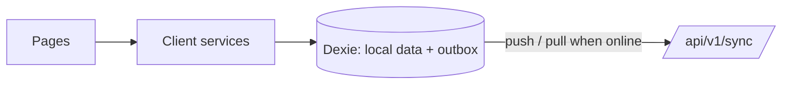

# STEAMLabs Africa Code Clubs Management System

## Architecture Overview

**Status:** Proposed (database: MongoDB, decided 22 Oct, D1-8)
**Sprint:** 1
**Last updated:** 2026-10-21

## 1. Purpose

This document describes the initial architecture for the STEAMLabs Africa Code Clubs Management System. The system centralises programme records that are currently coordinated through channels such as WhatsApp. It gives STEAMLabs one place to manage schools, clubs, staff and champion assignments, and later sessions, attendance, learners, projects, events and programme analytics across four regions: Nairobi & Central, Western & Nyanza, Coast and Rift Valley.

Two constraints shape the design:

- Most club venues have little or no internet. Since Sprint 3, champions and coordinators work offline and sync later (D3-1).
- Learners are children aged 9–14, so personal data must be minimised and restricted, in line with the Kenya Data Protection Act 2019.

## 2. Architecture principles

- Start with a modular monolith rather than microservices.
- Enforce authentication, authorisation (permission **and** resource scope), and validation on the server.
- Keep business rules in backend services, not only in React components.
- Reuse shared schemas and stable enums; never treat shared code as a security boundary.
- Put data access behind repositories, so the database engine (MongoDB, D1-8) stays in one layer.
- Sprints 1–2 were online-first; Sprint 3 added offline-first workflows for champions and coordinators.
- Minimise personal data, particularly information about children.
- Record sensitive administrative changes in an audit log.
- Test authorisation boundaries as well as successful workflows.
- English and Kiswahili from day one: all UI text goes through i18n.

## 3. Technology stack

| Layer                      | Technology                                                                                           | Purpose                                                                               | Status           |
| -------------------------- | ---------------------------------------------------------------------------------------------------- | ------------------------------------------------------------------------------------- | ---------------- |
| Frontend                   | React + Vite                                                                                         | User interface                                                                        | Accepted         |
| UI components and styling  | `steamlabsui` (STEAMLabs Africa UI kit): components, tokens, logo                                    | Consistent STEAMLabs branding                                                         | Accepted (D1-9)  |
| Fonts                      | Poppins, self-hosted                                                                                 | Works without internet                                                                | Accepted (D1-10) |
| Routing                    | React Router                                                                                         | Pages and role-aware navigation                                                       | Accepted         |
| Languages                  | react-i18next (`en`, `sw`)                                                                           | English and Kiswahili                                                                 | Accepted (D1-11) |
| Installable app            | vite-plugin-pwa                                                                                      | Installs on laptops, tablets and phones; the service worker caches the app shell only | Accepted         |
| Backend                    | Node.js 24 LTS + Express                                                                             | REST API                                                                              | Accepted         |
| Database                   | **MongoDB with Mongoose**                                                                            | Persistent records                                                                    | Accepted (D1-8)  |
| Shared validation          | Zod                                                                                                  | Request and data-shape validation, shared by client and server                        | Accepted         |
| Authentication             | Short-lived JWT access token + rotating refresh token in an httpOnly cookie; bcrypt password hashing | Authenticated requests                                                                | Proposed (D1-12) |
| Backend tests              | Jest + Supertest                                                                                     | API and service tests                                                                 | Accepted         |
| Test database              | mongodb-memory-server (in-process MongoDB)                                                           | Isolated tests, no install needed                                                     | Follows D1-8     |
| Frontend tests             | Vitest; Playwright for end-to-end                                                                    | Units and browser workflows                                                           | Accepted         |
| CI                         | GitHub Actions                                                                                       | Lint, test and build on every push and pull request                                   | Accepted         |
| Offline storage (Sprint 3) | Dexie / IndexedDB + outbox                                                                           | Local-first data and sync                                                             | Accepted (D3-2)  |

## 4. High-level architecture

Since Sprint 3, for champions and coordinators the client services read and write a local database (Dexie) with an outbox; pages call the same service functions (D3-1, `docs/sync-protocol.md`).

## 5. Backend module boundaries

Each business module has routes, controllers, services and a repository.

- `auth`: login, logout, refresh, current user, authentication helpers.
- `users`: account creation, role assignment, activation/deactivation, school/club/region assignments, champion profile (type, skills, safeguarding clearance).
- `schools`: school and host organisation registration, editing, listing, deactivation.
- `clubs`: club registration, school association, champion assignments, schedule, track, capacity, status.
- `learners`: learner registration, status (active or left), guardian contacts (HQ-only reading), consent and signed consent forms (Sprint 2).
- `sessions`: session reports, attendance, session photos and the 7-day edit window (Sprint 2).
- `audit`: recording and reviewing sensitive administrative events.
- `sync`: push of offline changes through the other modules' services, pull of changes in scope, and the conflict log (Sprint 3, `docs/sync-protocol.md`).

Routes define HTTP endpoints. Controllers translate requests and responses. Services enforce business rules and access scope. Repositories are the only code that talks to the database.

## 6. Shared package

`shared/` is a real npm workspace package with its own `package.json` and explicit exports.

- `enums.js`: roles, regions, counties, venue types, tracks, statuses.
- `permissions.js`: the role → permission → scope policy, in one place so roles can change after STEAMLabs confirms them.
- `schemas/`: Zod schemas for auth, users, schools, clubs, learners and sessions.
- `errors.js`: every API error text, shared by the server and the demo mock and translated by the client.
- `demo/`: the fictional dataset used by demo mode and `npm run seed` (D1-22).

Shared permission definitions are not a security boundary. The server independently authenticates users and enforces permissions and resource scope. Client-side permission checks only decide what to show.

Never put server secrets, database access or trusted authorisation decisions in `shared/`.

## 7. Data model: Sprint 1

Stored in MongoDB (D1-8). Collections, indexes and how scope becomes a query are in `docs/sprints/sprint-1-data-layer.md`. Every record has:

- `id`: UUID (stored as the MongoDB `_id`, D1-21), which can be generated on a device (needed for offline creation in Sprint 3)
- `createdAt`, `updatedAt`: server-controlled timestamps
- `createdBy`, `updatedBy`: user IDs
- `deactivatedAt` / `status`: records are deactivated, never hard-deleted (D1-6)

### User

| Field                                                        | Rules                                                                                                                       |
| ------------------------------------------------------------ | --------------------------------------------------------------------------------------------------------------------------- |
| `fullName`                                                   | Required                                                                                                                    |
| `email`                                                      | Unique, normalised (lower-case, trimmed)                                                                                    |
| `phone`                                                      | Kenyan format (`+2547…` / `+2541…`), optional                                                                               |
| `passwordHash`                                               | bcrypt; never returned by the API                                                                                           |
| `role`                                                       | `system_admin` \| `programme_manager` \| `coordinator` \| `champion`                                                        |
| `status`                                                     | `active` \| `inactive`                                                                                                      |
| `regions`                                                    | For coordinators: the regions they cover (assignment unit still to confirm, see open questions)                             |
| `championProfile`                                            | For champions: `type` (teacher, volunteer, staff), `skills`, `safeguarding { status: pending \| cleared \| expired, date }` |
| `permissionGrants`                                           | Extra permissions granted to one person, e.g. viewing learner contacts                                                      |
| `tokenVersion`, `failedLogins`, `lockedUntil`, `lastLoginAt` | Session invalidation and lockout                                                                                            |

### School (school or host organisation)

| Field                         | Rules                                                          |
| ----------------------------- | -------------------------------------------------------------- |
| `name`                        | Required; duplicate check on name + county + sub-county        |
| `type`                        | `primary_school` \| `community_centre` \| `library` \| `other` |
| `region`                      | One of the four regions                                        |
| `county`, `subCounty`, `ward` | County validated against Kenya's 47 counties                   |
| `gps`                         | Latitude/longitude, optional                                   |
| `contactName`, `contactPhone` | Host contact                                                   |
| `status`                      | `active` \| `inactive`                                         |

### Club

| Field                                             | Rules                                                                  |
| ------------------------------------------------- | ---------------------------------------------------------------------- |
| `code`                                            | Human-readable unique ID per region, e.g. `NAC-001`                    |
| `name`                                            | Required                                                               |
| `schoolId`                                        | Must reference an active school; empty only for online clubs           |
| `venueType`                                       | `primary_school` \| `community_centre` \| `library` \| `online`        |
| `region`                                          | Copied from the school for fast, scoped queries                        |
| `meetingDay`, `startTime`, `endTime`, `frequency` | Weekly, fortnightly or monthly                                         |
| `mainTrack`                                       | `unplugged` \| `scratch` \| `robotics` \| `game_design` \| `ai_basics` |
| `capacity`                                        | 1–30, default 30                                                       |
| `status`                                          | `active` \| `paused` \| `closed`                                       |

### ClubChampion (assignment)

A club can have several champions and a champion can run several clubs. Each assignment is its own record: `clubId`, `userId`, `role` (lead or assistant), `startDate`, `endDate`. History is kept when an assignment ends.

### Audit log

`at`, `actorId`, `actorRole`, `action`, `entityType`, `entityId`, `changedFields` (names, with sensitive values redacted), `requestId`. Append-only. No passwords, tokens or full request bodies.

### Sprint 2: learners, consent, sessions and attendance

Built in Sprint 2; the full field list and reasons are in `docs/sprints/sprint-2.md` section 5, the decisions in D2-1 to D2-9.

- `learners`: `learnerNumber` (e.g. `NAC-001-007`), names, `birthYear` (D2-2), gender, grade, admission number (unique per school), accessibility needs, `clubId`, `schoolId`, `region`, `status`, `joinedAt`, `leftAt`.
- `learnerContacts`: one per learner, readable by HQ only (D2-1).
- `consents`: one per learner and type (`participation`, `photo`), with status, `signedOn` and the GridFS `fileId` of the signed form.
- `sessions`: one per club per date; status, topic, notes, times, `photoIds` (max 3).
- `attendance`: one per learner per session (D2-4).
- GridFS buckets `consentFiles` and `sessionPhotos` (D2-3, D2-7).

### Later sprints (designed now, built later)

Events, Announcements, Equipment, Resources, Progress and, later, Certificates. See `docs/sprints/sprint-1.md` for the outline.

## 8. RBAC and resource scope

Roles (from Enock's Sprint 1 proposal; final permissions to be confirmed with STEAMLabs):

1. System Administrator
2. Programme Manager
3. Code Clubs Coordinator
4. Club Champion (the facilitator who runs a club: teacher, volunteer or staff)

Authorisation has two checks, both on the server:

1. **Permission:** is this role allowed to perform the action?
2. **Scope:** is this user allowed to perform it on this specific school or club?

Examples:

- A champion can only read their assigned clubs. Changing a club ID in the URL returns 404, so other clubs' existence is not revealed.
- A coordinator can only access schools and clubs within their assignment.
- A programme manager can oversee all programme records.
- Only authorised administrative users can create accounts or assign roles. Nobody can change their own role.

The policy lives in `shared/permissions.js`. Middleware `authorize(permission)` checks the permission; services apply the scope filter to every query and every write.

## 9. API conventions

Prefix: `/api/v1`. Endpoints for Sprint 1 are listed in `docs/sprints/sprint-1.md`.

- Consistent JSON responses: `{ data }` for one record, `{ data, page, pageSize, total }` for lists, `{ error: { code, message, details? } }` for errors.
- Validate request bodies, route parameters and query parameters.
- Never expose password hashes, tokens or stack traces.
- **Demo mode (D1-20):** `npm run demo` points the web app at an in-browser mock of this API (`client/src/services/mock/`). It reuses the shared schemas and permission policy, so the screens and their role rules can be shown and tested without a server or database. It is not part of real builds.

## 10. Offline strategy

Built in Sprint 3; the full protocol is in `docs/sync-protocol.md` and the decisions are D3-1 to D3-9.

- **Who:** Club Champions and Coordinators keep their own scope on the device. HQ roles stay online (D3-1).
- **Device:** one Dexie database per user with the scope's schools, clubs, learners, consent status, sessions (last 120 days and future) and attendance, plus an outbox and files waiting to upload. Deleted on sign-out and after 14 days without sync (D3-2).
- **Writes:** saved on the device first, checked with the same shared schemas and rules, and queued. `POST /sync/push` runs each change through the same service as its online endpoint and stores its result by `opId`, so repeats change nothing (D3-3).
- **Reads:** from the device once the first pull has finished. `GET /sync/pull` sends changes after a cursor in `(updatedAt, id)` order with a 2-minute overlap, tombstones for removed attendance, and a full reset when the user's clubs change (D3-4). Unsent changes are applied again after every pull.
- **Conflicts:** field-level merge; the later change wins and the replaced value is logged for coordinators and HQ (D3-5). Same-day sessions are joined (D3-6); attendance is merged per learner (D3-9).
- **Time:** the 7-day edit window uses the time on the device for changes up to 14 days old (D3-7).
- **Sensitive records:** guardian contacts, consent forms and photos stay on the device only until sent and are never pulled (D3-8).
- **Visible state:** a status pill on every screen ("Offline · 3 changes waiting to sync") and a Sync page with refused changes (try again, confirm, or discard) and the conflict log.

## 11. Security and privacy

- Hash passwords with bcrypt (cost 12).
- HTTPS in production; refresh cookie is httpOnly, Secure and SameSite.
- Rate-limit and lock out repeated failed logins.
- No secrets in frontend environment variables.
- Validate and authorise every protected API request; deny by default.
- Deactivated accounts lose access on their next request (account status checked on every request).
- Minimise learner personal data; guardian contacts are visible only to HQ roles unless granted.
- Audit logs never contain passwords, tokens or unnecessary sensitive payloads.
- Seed and test data are fictional.
- Kenya Data Protection Act 2019: see risk R1-13.

## 12. Deployment and configuration

Separate environment examples:

Client (`client/.env.example`):

- `VITE_API_URL`

Server (`server/.env.example`):

- `NODE_ENV`, `PORT`
- `MONGODB_URI` (MongoDB connection string, D1-8)
- `JWT_ACCESS_SECRET`, `JWT_REFRESH_SECRET`
- `CORS_ORIGIN`
- `SEED_DEFAULT_PASSWORD` (development only)

Never commit real `.env` files or production secrets. Windows setup steps are in the root `README.md`.

## 13. What to show on Friday 23 October

Friday is a checkpoint, not the end of the sprint. Stakeholders should see:

1. **Tech stack:** section 3 of this document, with the reasons in `docs/decision-log.md`.
2. **Architecture:** the diagrams in section 4 and the role/scope model in section 8.
3. **Coding principles applied:** `docs/coding-principles.md`, shown in the running repo: workspaces, shared Zod schemas, permission and scope middleware with passing negative tests, the steamlabsui screens in English and Kiswahili, and CI running on every push.
4. **Clickable demo:** `npm run demo`, signing in as each of the four roles to show that a Club Champion sees only their own clubs and a Coordinator only their region.

Offline use and sync were added in Sprint 3 (`docs/sync-protocol.md`).
