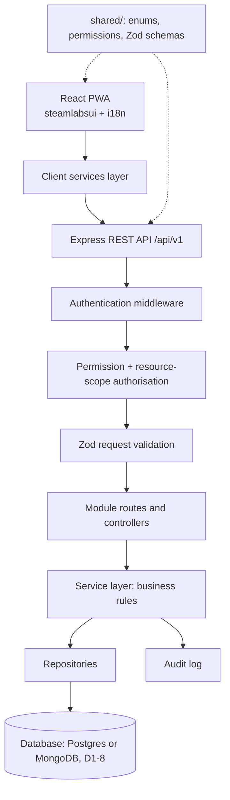
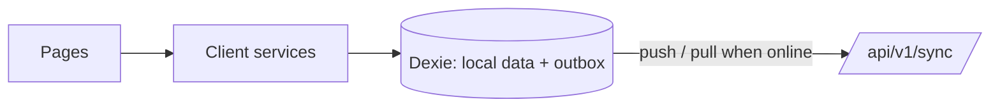

# STEAMLabs Africa Code Clubs Management System

## Architecture Overview

**Status:** Proposed (database choice pending, see D1-8)
**Sprint:** 1
**Last updated:** 2026-10-21

## 1. Purpose

This document describes the initial architecture for the STEAMLabs Africa Code Clubs Management System. The system centralises programme records that are currently coordinated through channels such as WhatsApp. It gives STEAMLabs one place to manage schools, clubs, staff and champion assignments, and later sessions, attendance, learners, projects, events and programme analytics across four regions: Nairobi & Central, Western & Nyanza, Coast and Rift Valley.

Two constraints shape the design:

- Most club venues have little or no internet. The app must eventually work fully offline and sync later (Sprint 3).
- Learners are children aged 9–14, so personal data must be minimised and restricted, in line with the Kenya Data Protection Act 2019.

## 2. Architecture principles

- Start with a modular monolith rather than microservices.
- Enforce authentication, authorisation (permission **and** resource scope), and validation on the server.
- Keep business rules in backend services, not only in React components.
- Reuse shared schemas and stable enums; never treat shared code as a security boundary.
- Put data access behind repositories, so the database choice (D1-8) stays in one layer.
- Keep Sprints 1–2 online-first; add real offline-first workflows in Sprint 3.
- Minimise personal data, particularly information about children.
- Record sensitive administrative changes in an audit log.
- Test authorisation boundaries as well as successful workflows.
- English and Kiswahili from day one: all UI text goes through i18n.

## 3. Technology stack

| Layer                      | Technology                                                                                           | Purpose                                                                 | Status           |
| -------------------------- | ---------------------------------------------------------------------------------------------------- | ----------------------------------------------------------------------- | ---------------- |
| Frontend                   | React + Vite                                                                                         | User interface                                                          | Accepted         |
| UI components and styling  | `steamlabsui` (STEAMLabs Africa UI kit): components, tokens, logo                                    | Consistent STEAMLabs branding                                           | Accepted (D1-9)  |
| Fonts                      | Poppins, self-hosted                                                                                 | Works without internet                                                  | Accepted (D1-10) |
| Routing                    | React Router                                                                                         | Pages and role-aware navigation                                         | Accepted         |
| Languages                  | react-i18next (`en`, `sw`)                                                                           | English and Kiswahili                                                   | Accepted (D1-11) |
| Installable app            | vite-plugin-pwa                                                                                      | Installs on laptops, tablets and phones; offline data comes in Sprint 3 | Accepted         |
| Backend                    | Node.js 24 LTS + Express                                                                             | REST API                                                                | Accepted         |
| Database                   | **PostgreSQL or MongoDB: pending**                                                                   | Persistent records                                                      | Pending (D1-8)   |
| Shared validation          | Zod                                                                                                  | Request and data-shape validation, shared by client and server          | Accepted         |
| Authentication             | Short-lived JWT access token + rotating refresh token in an httpOnly cookie; bcrypt password hashing | Authenticated requests                                                  | Proposed (D1-12) |
| Backend tests              | Jest + Supertest                                                                                     | API and service tests                                                   | Accepted         |
| Test database              | In-process database for the chosen engine (PGlite for Postgres, mongodb-memory-server for MongoDB)   | Isolated tests, no install needed                                       | Follows D1-8     |
| Frontend tests             | Vitest; Playwright for end-to-end                                                                    | Units and browser workflows                                             | Accepted         |
| CI                         | GitHub Actions                                                                                       | Lint, test and build on every push and pull request                     | Accepted         |
| Offline storage (Sprint 3) | Dexie / IndexedDB + outbox                                                                           | Local-first data and sync                                               | Planned          |

## 4. High-level architecture

In Sprint 3 the client services layer gains a local database (Dexie) and an outbox; pages do not change.

## 5. Backend module boundaries

Each business module has routes, controllers, services and a repository.

- `auth`: login, logout, refresh, current user, authentication helpers.
- `users`: account creation, role assignment, activation/deactivation, school/club/region assignments, champion profile (type, skills, safeguarding clearance).
- `schools`: school and host organisation registration, editing, listing, deactivation.
- `clubs`: club registration, school association, champion assignments, schedule, track, capacity, status.
- `audit`: recording and reviewing sensitive administrative events.
- `sync`: reserved for Sprint 3; no offline synchronisation in Sprints 1–2.

Routes define HTTP endpoints. Controllers translate requests and responses. Services enforce business rules and access scope. Repositories are the only code that talks to the database.

## 6. Shared package

`shared/` is a real npm workspace package with its own `package.json` and explicit exports.

- `enums.js`: roles, regions, counties, venue types, tracks, statuses.
- `permissions.js`: the role → permission → scope policy, in one place so roles can change after STEAMLabs confirms them.
- `schemas/`: Zod schemas for auth, users, schools and clubs.

Shared permission definitions are not a security boundary. The server independently authenticates users and enforces permissions and resource scope. Client-side permission checks only decide what to show.

Never put server secrets, database access or trusted authorisation decisions in `shared/`.

## 7. Data model: Sprint 1

Written independently of the database engine (D1-8). Every record has:

- `id`: UUID, which can be generated on a device (needed for offline creation in Sprint 3)
- `createdAt`, `updatedAt`: server-controlled timestamps
- `createdBy`, `updatedBy`: user IDs
- `deactivatedAt` / `status`: records are deactivated, never hard-deleted (D1-6)

### User

| Field                                                        | Rules                                                                                                                       |
| ------------------------------------------------------------ | --------------------------------------------------------------------------------------------------------------------------- |
| `fullName`                                                   | Required                                                                                                                    |
| `email`                                                      | Unique, normalised (lower-case, trimmed)                                                                                    |
| `phone`                                                      | Kenyan format (`+2547…` / `+2541…`), optional                                                                               |
| `passwordHash`                                               | bcrypt; never returned by the API                                                                                           |
| `role`                                                       | `system_admin` \| `programme_manager` \| `coordinator` \| `champion`                                                        |
| `status`                                                     | `active` \| `inactive`                                                                                                      |
| `regions`                                                    | For coordinators: the regions they cover (assignment unit still to confirm, see open questions)                             |
| `championProfile`                                            | For champions: `type` (teacher, volunteer, staff), `skills`, `safeguarding { status: pending \| cleared \| expired, date }` |
| `permissionGrants`                                           | Extra permissions granted to one person, e.g. viewing learner contacts                                                      |
| `tokenVersion`, `failedLogins`, `lockedUntil`, `lastLoginAt` | Session invalidation and lockout                                                                                            |

### School (school or host organisation)

| Field                         | Rules                                                          |
| ----------------------------- | -------------------------------------------------------------- |
| `name`                        | Required; duplicate check on name + county + sub-county        |
| `type`                        | `primary_school` \| `community_centre` \| `library` \| `other` |
| `region`                      | One of the four regions                                        |
| `county`, `subCounty`, `ward` | County validated against Kenya's 47 counties                   |
| `gps`                         | Latitude/longitude, optional                                   |
| `contactName`, `contactPhone` | Host contact                                                   |
| `status`                      | `active` \| `inactive`                                         |

### Club

| Field                                             | Rules                                                                  |
| ------------------------------------------------- | ---------------------------------------------------------------------- |
| `code`                                            | Human-readable unique ID per region, e.g. `NAC-001`                    |
| `name`                                            | Required                                                               |
| `schoolId`                                        | Must reference an active school; empty only for online clubs           |
| `venueType`                                       | `primary_school` \| `community_centre` \| `library` \| `online`        |
| `region`                                          | Copied from the school for fast, scoped queries                        |
| `meetingDay`, `startTime`, `endTime`, `frequency` | Weekly, fortnightly or monthly                                         |
| `mainTrack`                                       | `unplugged` \| `scratch` \| `robotics` \| `game_design` \| `ai_basics` |
| `capacity`                                        | 1–30, default 30                                                       |
| `status`                                          | `active` \| `paused` \| `closed`                                       |

### ClubChampion (assignment)

A club can have several champions and a champion can run several clubs. Each assignment is its own record: `clubId`, `userId`, `role` (lead or assistant), `startDate`, `endDate`. History is kept when an assignment ends.

### Audit log

`at`, `actorId`, `actorRole`, `action`, `entityType`, `entityId`, `changedFields` (names, with sensitive values redacted), `requestId`. Append-only. No passwords, tokens or full request bodies.

### Later sprints (designed now, built later)

Learner and a separate LearnerContact record (guardian contacts visible only to HQ unless granted), Session and Attendance, consent attachments, Events, Announcements, Equipment, Resources, Progress and, later, Certificates. See `docs/sprints/sprint-1.md` for the outline.

## 8. RBAC and resource scope

Roles (from Enock's Sprint 1 proposal; final permissions to be confirmed with STEAMLabs):

1. System Administrator
2. Programme Manager
3. Code Clubs Coordinator
4. Club Champion (the facilitator who runs a club: teacher, volunteer or staff)

Authorisation has two checks, both on the server:

1. **Permission:** is this role allowed to perform the action?
2. **Scope:** is this user allowed to perform it on this specific school or club?

Examples:

- A champion can only read their assigned clubs. Changing a club ID in the URL returns 404, so other clubs' existence is not revealed.
- A coordinator can only access schools and clubs within their assignment.
- A programme manager can oversee all programme records.
- Only authorised administrative users can create accounts or assign roles. Nobody can change their own role.

The policy lives in `shared/permissions.js`. Middleware `authorize(permission)` checks the permission; services apply the scope filter to every query and every write.

## 9. API conventions

Prefix: `/api/v1`. Endpoints for Sprint 1 are listed in `docs/sprints/sprint-1.md`.

- Consistent JSON responses: `{ data }` for one record, `{ data, page, pageSize, total }` for lists, `{ error: { code, message, details? } }` for errors.
- Validate request bodies, route parameters and query parameters.
- Never expose password hashes, tokens or stack traces.

## 10. Offline strategy

Sprints 1–2 are online-first. The client services layer isolates API access so Sprint 3 can introduce Dexie without rewriting pages. Records already use device-generatable UUIDs and are never hard-deleted.

Sprint 3 will define and test:

- an outbox queue and idempotent push operations (a repeated push never creates duplicates);
- scoped pull operations with a change cursor;
- conflict detection and resolution (last write wins per field, with conflicts logged);
- deletion tombstones;
- retry and failure states, and a visible sync status ("Saved on this device · 3 changes waiting to sync");
- cursor recovery and full resynchronisation;
- protection of personal data stored on shared devices.

A change sequence alone does not make a sync protocol; Sprint 3 designs the full protocol in `docs/sync-protocol.md`.

## 11. Security and privacy

- Hash passwords with bcrypt (cost 12).
- HTTPS in production; refresh cookie is httpOnly, Secure and SameSite.
- Rate-limit and lock out repeated failed logins.
- No secrets in frontend environment variables.
- Validate and authorise every protected API request; deny by default.
- Deactivated accounts lose access on their next request (account status checked on every request).
- Minimise learner personal data; guardian contacts are visible only to HQ roles unless granted.
- Audit logs never contain passwords, tokens or unnecessary sensitive payloads.
- Seed and test data are fictional.
- Kenya Data Protection Act 2019: see risk R1-13.

## 12. Deployment and configuration

Separate environment examples:

Client (`client/.env.example`):

- `VITE_API_URL`

Server (`server/.env.example`):

- `NODE_ENV`, `PORT`
- `DATABASE_URL` (connection string for the engine chosen in D1-8)
- `JWT_ACCESS_SECRET`, `JWT_REFRESH_SECRET`
- `CORS_ORIGIN`
- `SEED_DEFAULT_PASSWORD` (development only)

Never commit real `.env` files or production secrets. Windows setup steps are in the root `README.md`.

## 13. What to show on Friday 23 October

Friday is a checkpoint, not the end of the sprint. Stakeholders should see:

1. **Tech stack:** section 3 of this document, with the reasons in `docs/decision-log.md`.
2. **Architecture:** the diagrams in section 4 and the role/scope model in section 8.
3. **Coding principles applied:** `docs/coding-principles.md`, shown in the running repo: workspaces, shared Zod schemas, permission and scope middleware with passing negative tests, the steamlabsui app shell in English and Kiswahili, and CI running on every push.

Offline synchronisation is presented as a planned Sprint 3 capability, not a finished feature.
